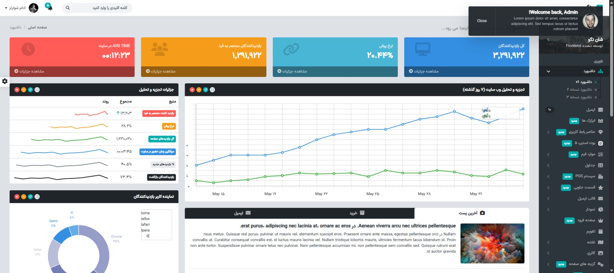
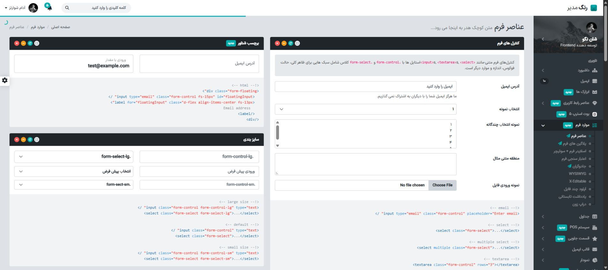
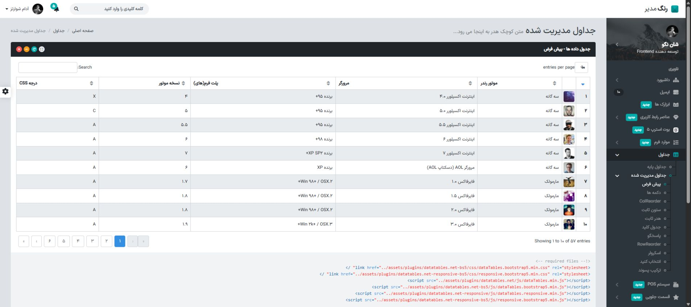

# Color Admin 5.4.2 — نسخه HTML فارسی و راست‌چین

این مخزن خروجی HTML قالب مدیریت **Color Admin 5.4.2** را با چیدمان راست‌به‌چپ، متن‌های فارسی و فونت IRANSansX ارائه می‌کند. صفحات نمونه برای شروع طراحی پنل مدیریت و بررسی اجزای قالب آماده‌اند.

## امکانات

- ۱۰۹ صفحه HTML شامل چند داشبورد، فرم‌ها، جدول‌ها، نمودارها، تقویم، گالری و صفحات ورود و ثبت‌نام
- نمونه‌هایی از مدیریت سفارش و محصول، صندوق فروش، صندوق ورودی و اجزای رابط کاربری
- چیدمان راست‌به‌چپ با استایل RTL خود قالب
- ترجمه ماشینی متن‌های نمایشی و استفاده از فونت IRANSansX در وزن‌های Regular و Medium
- فایل‌های CSS، JavaScript، تصاویر و افزونه‌های موردنیاز در پوشه `assets`

## تصاویر نمونه

### داشبورد



### فرم‌ها



### جدول‌ها



## شروع استفاده

پوشه مخزن را دریافت کنید و فایل `pages/index.html` را در مرورگر باز کنید. برای استفاده مطمئن‌تر از بخش‌هایی که فایل داده دریافت می‌کنند، پوشه پروژه را با یک وب‌سرور محلی اجرا کنید. برای مثال، اگر Node.js نصب است:

```bash
npx --yes http-server .
```

سپس مسیر `/pages/index.html` را در آدرسی که سرور نمایش می‌دهد باز کنید. مسیر نسبی پوشه‌های `pages` و `assets` باید حفظ شود.

## ساختار پروژه

```text
pages/        صفحات HTML
assets/       استایل‌ها، اسکریپت‌ها، تصاویر، فونت‌ها و افزونه‌ها
screenshots/  تصاویر نمونه صفحات
```

## نکات

این خروجی عمدتاً رابط کاربری و داده‌های نمونه را شامل می‌شود؛ ورود کاربران، ذخیره‌سازی و اتصال به پایگاه داده به پیاده‌سازی سمت سرور نیاز دارند. بخشی از متن‌های افزونه‌ها، داده‌های نمونه و متن‌هایی که با JavaScript ساخته می‌شوند ممکن است هنوز انگلیسی باشند. ترجمه‌های ماشینی نیز ممکن است به بازبینی نیاز داشته باشند.

Color Admin و فونت IRANSansX دارایی‌های صاحبان اصلی خود هستند و استفاده یا بازنشر آن‌ها تابع مجوزهای مربوط است. این مخزن مجوز جدیدی برای این دارایی‌ها اعطا نمی‌کند.
